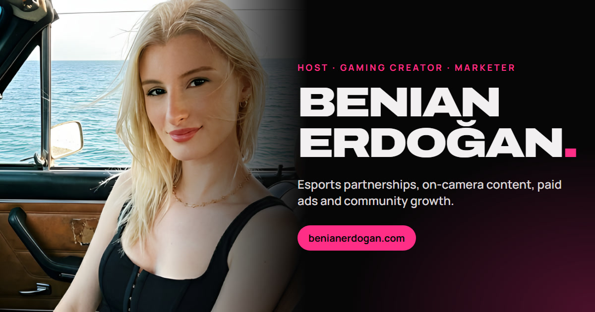

# benianerdogan.com

Personal portfolio of **Benian Erdoğan**: on-camera host, gaming creator and marketer.

**Live site:** https://benianerdogan.com



## What's inside

- A 1080p showreel at the top of the page (`media/showreel.mp4`).
- Selected work: GG Clan, İlave TV, esports tournaments and broadcasts, Omchain, AI and automation, gaming content and affiliates.
- A detail panel for each project with the role, dates, what I did and the numbers, including GG Clan's paid campaign results across TikTok, Meta, Snapchat, Amazon/Twitch and Reddit.
- Contact links and a calendar link to book a meeting.

## Built with

- One hand-written HTML file with CSS and vanilla JavaScript. No framework, no build step.
- Showreel made in [Remotion](https://www.remotion.dev/), with FFmpeg for editing and Real-ESRGAN for upscaling.
- Hosted on Netlify.

## Run it locally

Open `index.html` in a browser, or serve the folder:

```bash
npx serve .
```

## Contact

- Email: benian@ggclan.com
- LinkedIn: https://www.linkedin.com/in/benianroden
- X: https://x.com/benianroden
